<div align="center">

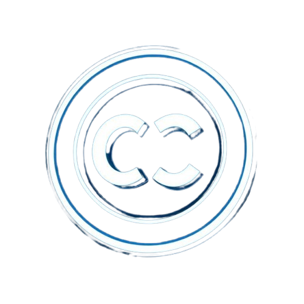

# Chat-Craft

**A chatbot-as-a-service platform that answers questions from your organization's internal documents using retrieval-augmented generation (RAG).**

Upload your docs, get a trained assistant, and embed it anywhere with a single `<iframe>`.


</div>

---

<p align="center">
  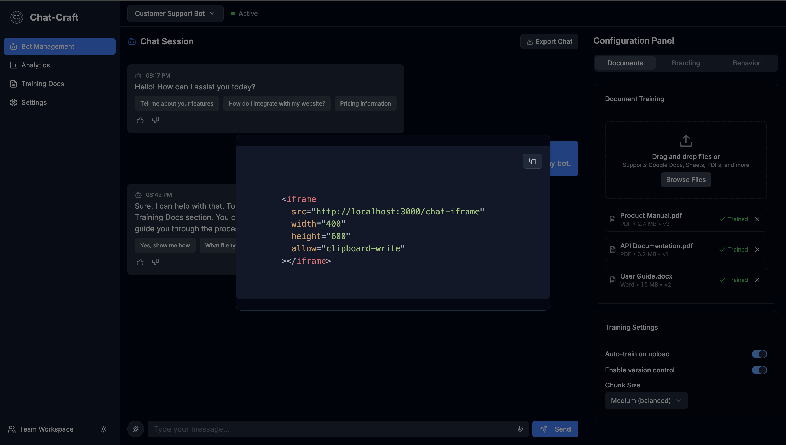
</p>

## The problem

Inside most companies, answers live in scattered PDFs, wikis, Google Docs and spreadsheets. People waste time searching or asking the same questions again and again. Chat-Craft turns that knowledge into a private, context-aware assistant. It answers from *your* documents, not from the open internet.

## Features

- **Document ingestion and vectorization**: upload PDFs, DOCX, CSV and HTML files. They're split into chunks, embedded and indexed automatically.
- **Semantic retrieval**: MongoDB Atlas Vector Search finds the most relevant passages for every query, scoped to each user or tenant.
- **Grounded LLM answers**: Llama 2 (run locally through Ollama) generates structured answers from the retrieved context only.
- **Embeddable widget**: copy one `<iframe>` snippet into an intranet, Confluence, Notion or any website.
- **Admin dashboard**: manage bots, train on documents, configure branding and behavior, and generate API keys.
- **Usage analytics**: question volume, trending topics, sentiment, and auto-generated FAQs from chat logs.
- **Live document sync**: a Go cron scheduler watches Google Sheets and Docs for changes so the knowledge base stays fresh.
- **Microservices architecture**: each service is independently deployable and tested.

## Product tour

<table>
  <tr>
    <td width="50%">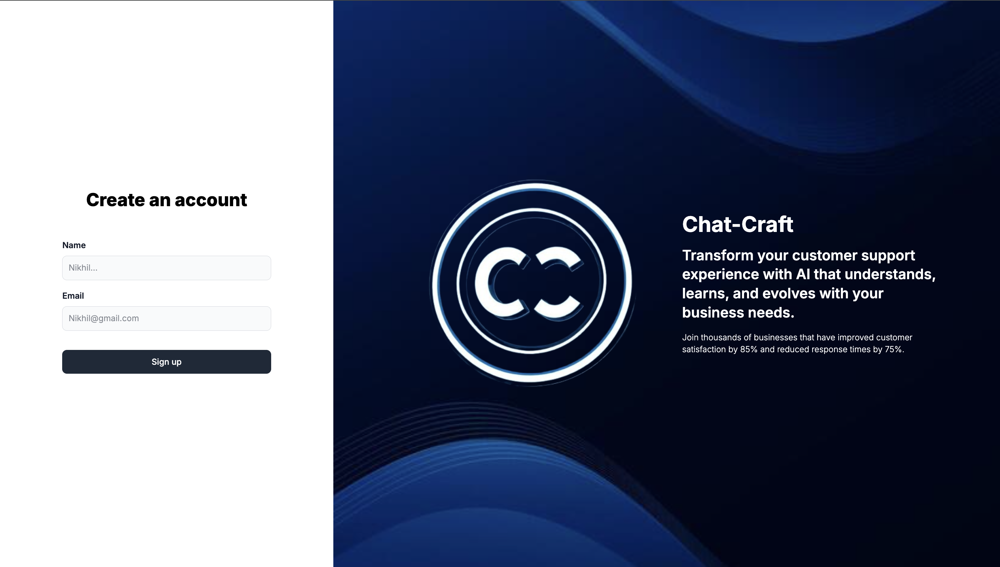<p align="center"><b>Sign in</b></p></td>
    <td width="50%">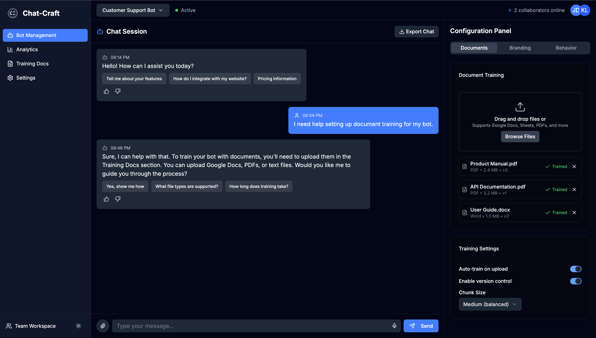<p align="center"><b>Train on your documents</b></p></td>
  </tr>
  <tr>
    <td width="50%">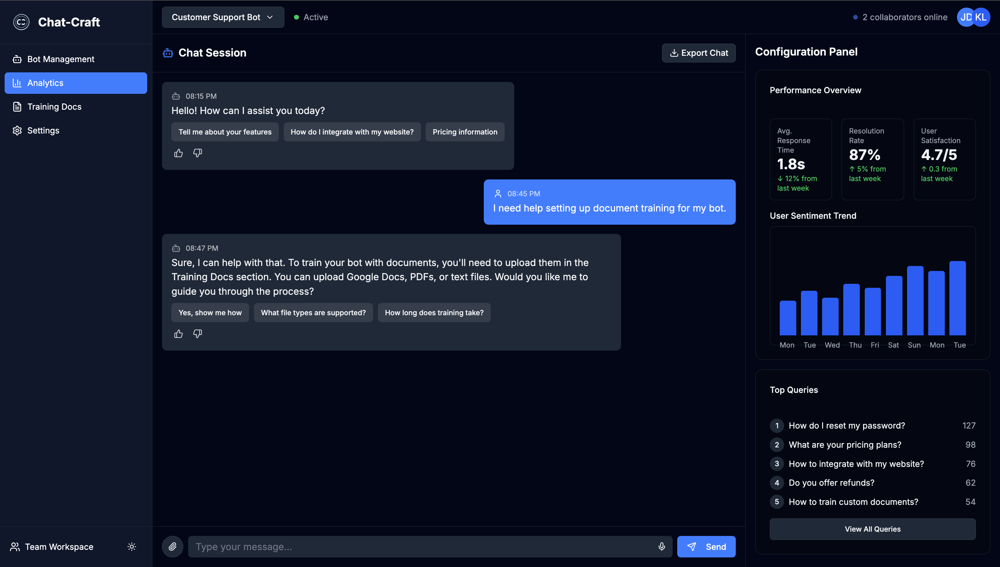<p align="center"><b>Analytics dashboard</b></p></td>
    <td width="50%">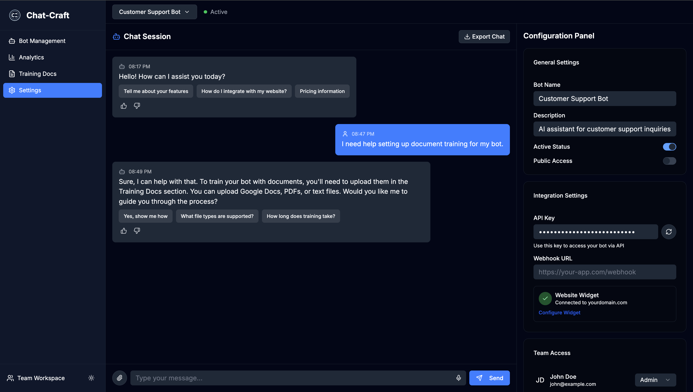<p align="center"><b>API key management</b></p></td>
  </tr>
</table>

## Architecture

<p align="center">
  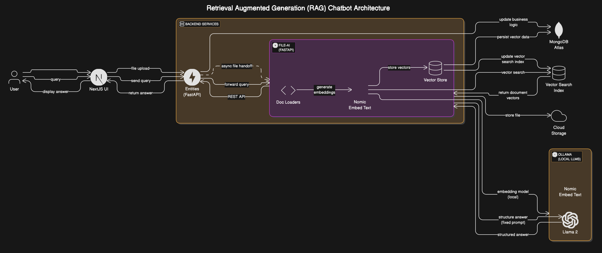
</p>

A Next.js frontend talks to the **Entities service**, which owns users, auth and bots. Document work and AI queries go to the **File-AI service**, which handles chunking, embeddings, vector storage and LLM inference. Chat logs go to **Chat Metrics** for analysis, and the **Cron-job** service watches external Google sources for updates.

### How a question gets answered

<p align="center">
  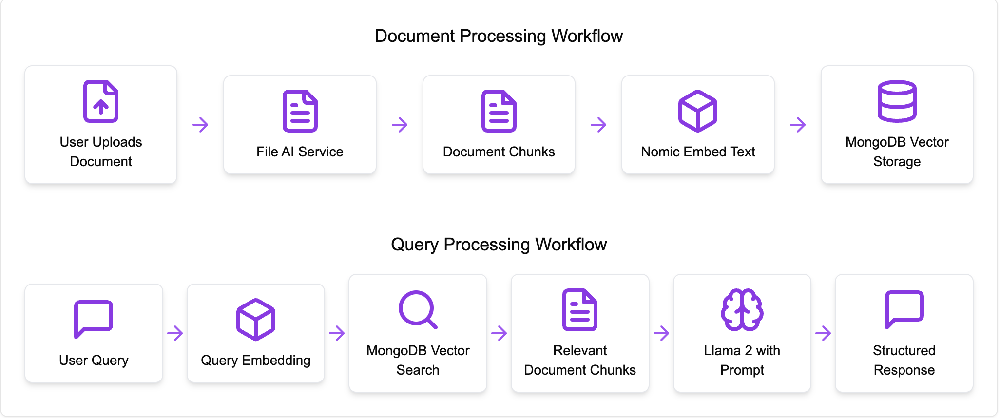
</p>

**Ingestion**
1. A user uploads documents from the dashboard.
2. File-AI parses them and splits them into overlapping chunks.
3. `nomic-embed-text` turns each chunk into a 768-dimension vector.
4. The vectors are stored in MongoDB Atlas with user metadata for filtering.

**Query**
1. A user asks a question in the chat UI or the embedded widget.
2. The question is embedded with the same model.
3. Atlas Vector Search returns the top matching chunks for that user.
4. The chunks and a structured prompt go to Llama 2.
5. The grounded answer streams back to the chat interface.

## Analytics

The `chat-metrics` service mines chat logs to show what users are asking about and how they feel about the answers.

<table>
  <tr>
    <td>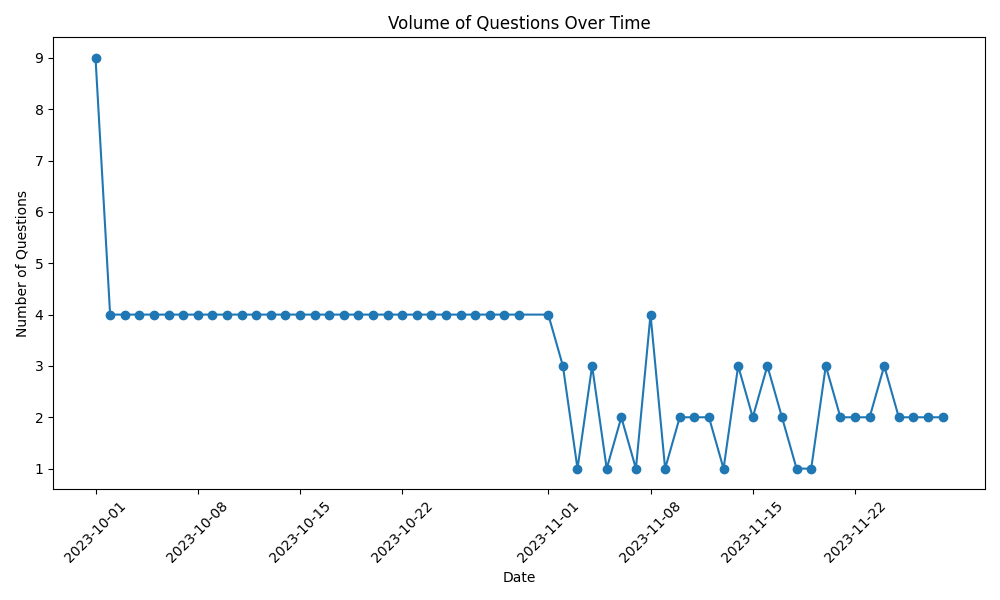</td>
    <td>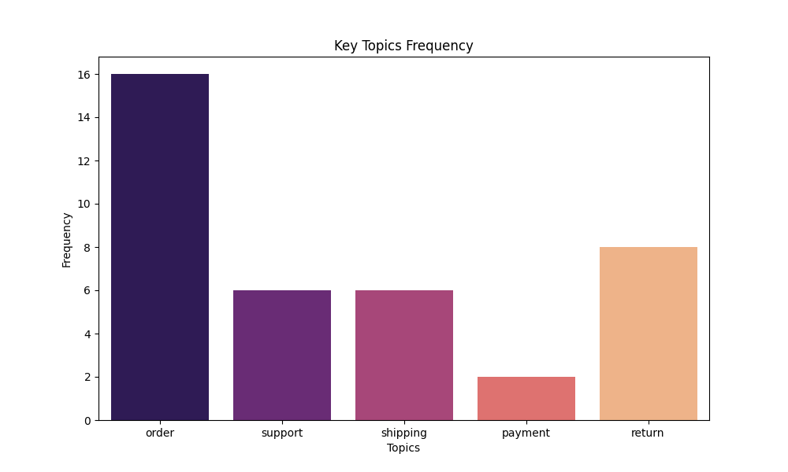</td>
    <td>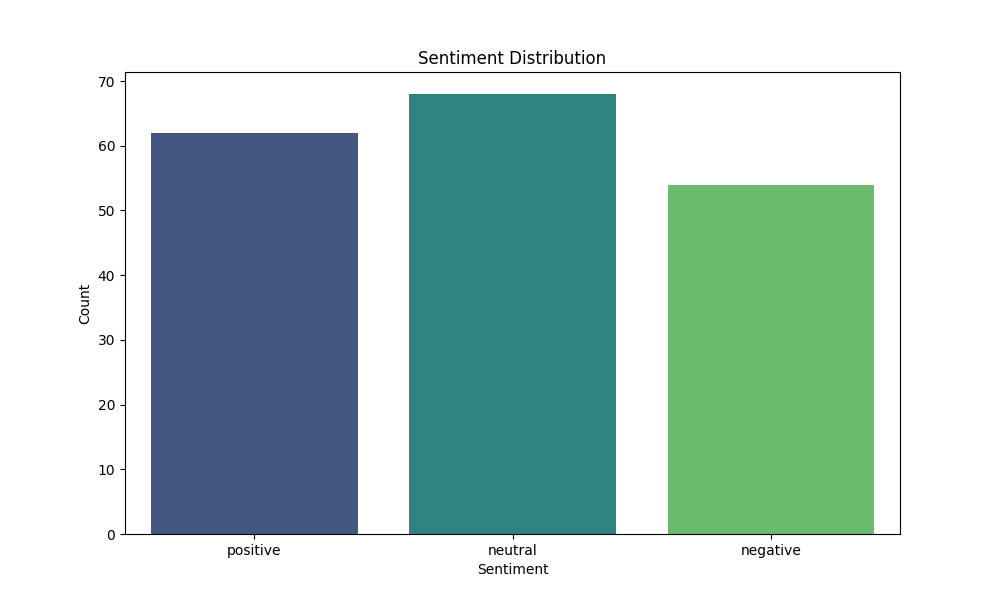</td>
  </tr>
  <tr>
    <td align="center">Question volume</td>
    <td align="center">Top topics</td>
    <td align="center">Sentiment</td>
  </tr>
</table>

## Tech stack

| Layer | Technologies |
| --- | --- |
| Frontend | Next.js 15, React 19, TypeScript, Tailwind CSS, Radix UI, Jotai |
| Backend services | Python, FastAPI, Go |
| AI / RAG | LangChain, Ollama, Llama 2, Nomic Embed Text |
| Data | MongoDB Atlas, Atlas Vector Search |
| Integrations | Google Sheets API, Google Docs API |
| Analytics | Python, pandas, matplotlib |

## Repository layout

```
chat-craft/
├── ui/              # Next.js admin dashboard + embeddable chat iframe
├── Chatbot-ui/      # Standalone React chatbot front-end
├── entities/        # FastAPI service: users, auth (signup / email login), bots, files
├── file-ai/         # FastAPI service: upload, chunk, embed, vector search, LLM prompt
├── rag-initial/     # RAG prototype (LangChain + Atlas, plus Llama.cpp + FAISS notebook)
├── chat-metrics/    # Chat log analytics, visualizations and auto-FAQ
├── Cron-job/        # Go scheduler + Python Google Sheets/Docs change monitor
├── orchestrator/    # Service orchestration (WIP)
└── org-github/      # Design assets: architecture diagram, workflow, screenshots
```

Each folder has its own README with detailed setup instructions.

## Getting started

### Prerequisites
- Node.js 18 or later
- Python 3.8 or later
- Go (for the cron job)
- A MongoDB Atlas cluster with a vector search index
- [Ollama](https://ollama.ai) running locally

### 1. Pull the models
```bash
ollama pull nomic-embed-text
ollama pull llama2
ollama serve
```

### 2. Start the backend services
```bash
# File-AI service
cd file-ai
python -m venv venv && source venv/bin/activate
pip install -r requirements.txt
# create .env (see file-ai/README.md)
uvicorn main:app --port 8001

# Entities service (new terminal)
cd entities
python -m venv venv && source venv/bin/activate
pip install -r requirements.txt
# create .env (see entities/README.md)
uvicorn main:app --reload
```

### 3. Start the frontend
```bash
cd ui
npm install
npm run dev
```

Open http://localhost:3000, sign up, upload a document and start chatting.

### 4. Embed the chatbot
```html
<iframe
  src="http://localhost:3000/chat-iframe"
  width="400"
  height="600"
  allow="clipboard-write"
></iframe>
```

## Testing

The backend services ship with test suites:

```bash
cd entities && python -m pytest tests/unit_tests.py -v
cd file-ai && python -m pytest tests/unit_tests.py
```

<table>
  <tr>
    <td>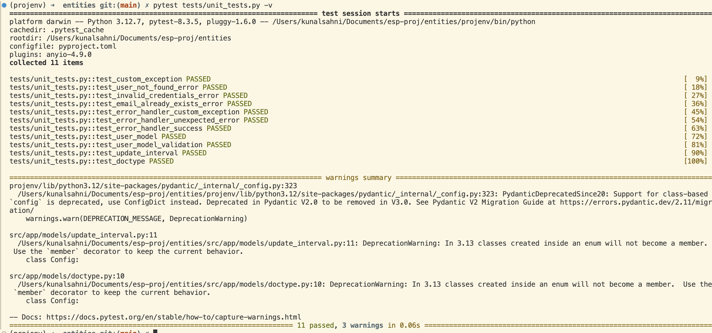</td>
    <td>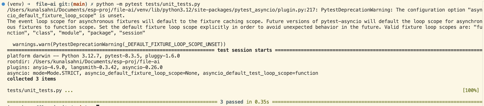</td>
  </tr>
  <tr>
    <td align="center">Entities service tests</td>
    <td align="center">File-AI service tests</td>
  </tr>
</table>

## Use cases

- Internal IT and HR help desks
- Onboarding and training assistants
- Q&A over technical documentation
- Customer support knowledge bases

## License

Individual services are licensed under the terms in their respective `LICENSE` files.
